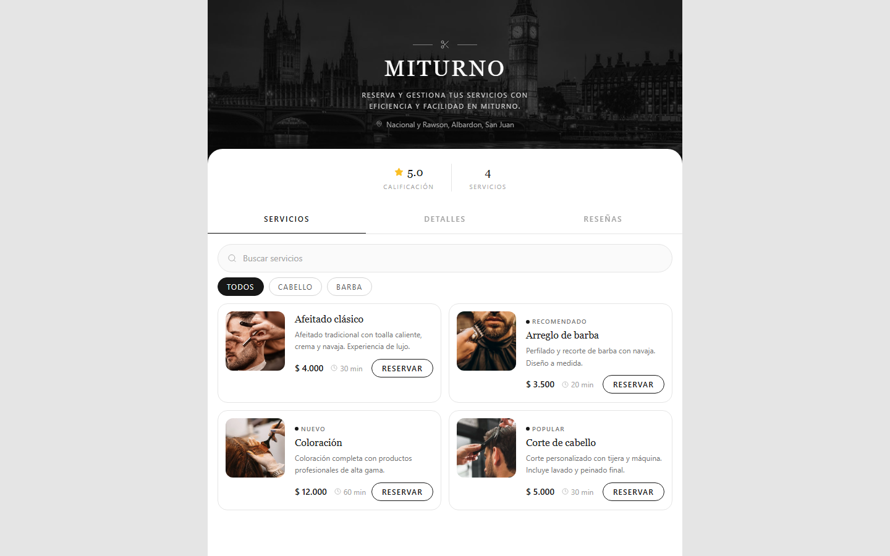
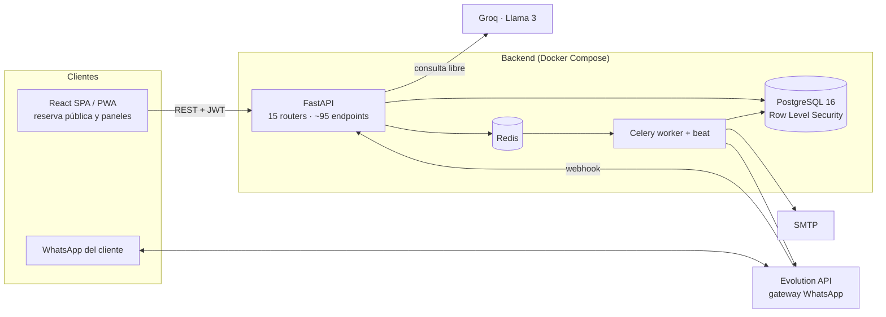

# MiTurno — SaaS multi-tenant de turnos para negocios de servicios


> **Plataforma de reservas donde varios negocios (barberías, peluquerías, profesionales independientes) comparten una sola aplicación con sus datos aislados a nivel de base de datos.**
> Reservas públicas, panel del negocio, panel por profesional, recordatorios automáticos, lista de espera y un bot de WhatsApp con IA.

**[Ver demo en vivo →](https://miturno.alejomonardez.com/miturno)** · [Portfolio](https://alejomonardez.com)

*English summary: a multi-tenant booking SaaS built with FastAPI, PostgreSQL (tenant isolation enforced with Row Level Security), Celery/Redis background jobs and a React SPA. Includes public booking pages, role-based dashboards (super-admin, business, professional), automated email/WhatsApp reminders, a smart waitlist, commission tracking, customer segmentation and a hybrid rule-based + LLM WhatsApp bot. Designed, built and deployed end-to-end by one developer.*



---

## El problema

Los negocios chicos de servicios agendan turnos por WhatsApp, en una agenda de papel o en planillas sueltas. Eso produce **dobles reservas**, clientes que no se enteran de una cancelación, nadie que mande recordatorios y **cero visibilidad** sobre cuánto factura cada profesional o qué horarios quedan vacíos.

## La solución

| Módulo | Qué resuelve |
|---|---|
| **Reserva pública** | El cliente elige servicio, profesional, día y horario desde la página del negocio. Los horarios libres se calculan en el servidor (horario recurrente + excepciones + duración y *buffer* de cada servicio, en bloques de 15 min). |
| **Panel del negocio** | Calendario, servicios y categorías, profesionales y horarios, clientes, reseñas, caja diaria y reportes. |
| **Panel por profesional** *(Premium)* | Cada profesional ve sólo sus turnos, su comisión (% o monto fijo) y el historial de sus clientes, sin acceso a la caja completa. |
| **Recordatorios automáticos** | Turno próximo, frecuencia e inasistencia, por email o WhatsApp. Un *worker* de Celery revisa cada minuto los vencidos. Link de baja incluido. |
| **Lista de espera inteligente** | Si un día está lleno, el cliente se anota. Cuando alguien cancela, el sistema le ofrece el lugar por WhatsApp; con responder "SÍ" se crea la reserva. |
| **Bot de WhatsApp 24/7** *(Premium)* | Agenda turnos conversando, responde precios, horarios y dirección, detecta quejas y reconoce al cliente por su historial. |
| **Segmentación de clientes** | Nuevo / regular / fiel / en riesgo, según turnos completados e inasistencias, para saber a quién recontactar. |
| **Planes y super-admin** | Planes Básico / Pro / Premium con límites (por ejemplo, cantidad de profesionales) verificados en el backend; un panel de super-admin gestiona los negocios. |
| **PWA** | Se instala como app tanto para el negocio como para cada profesional. |

## Decisiones técnicas destacadas

**1. Aislamiento multi-tenant en la base de datos, no sólo en el código.**
Las 16 tablas con datos de negocio tienen **Row Level Security forzado** (`ENABLE` + `FORCE ROW LEVEL SECURITY`). En cada request, la sesión de SQLAlchemy fija con `SET LOCAL` el usuario, el negocio y el rol; las políticas de PostgreSQL filtran con esos valores. Si un endpoint olvidara filtrar por `negocio_id`, la base igual no devolvería datos de otro negocio.

```python
# app/db/session.py (resumen)
connection.execute(text("SET LOCAL app.current_negocio_id = :nid"), {"nid": negocio_id})
connection.execute(text("SET LOCAL app.current_user_rol = :rol"), {"rol": rol})
```

**2. Doble reserva imposible por diseño.**
Un **índice único parcial** sobre `(profesional_id, inicio)` sólo para reservas confirmadas: dos requests simultáneos no pueden tomar el mismo horario, y una reserva cancelada libera el lugar.

```python
Index("uq_reserva_prof_inicio_confirmada", "profesional_id", "inicio",
      unique=True, postgresql_where=text("estado = 'confirmada'"))
```

**3. Bot híbrido: reglas primero, IA sólo cuando hace falta.**
Los mensajes pasan por un enrutador en orden: (1) confirmación de una oferta de lista de espera, (2) intenciones comunes resueltas con expresiones regulares y datos reales del negocio, sin costo de IA, (3) consulta libre a **Groq (Llama 3)** con un *prompt* armado con la base de conocimiento del negocio y reglas para que no invente información. La reserva por chat es una **máquina de estados** persistida en la base (servicio → profesional → día → hora → confirmación) que valida disponibilidad con la misma lógica que la web.

**4. Trabajo pesado fuera del request.**
Envío de emails y mensajes de WhatsApp en **Celery + Redis** con un `beat` que corre cada minuto. Sin credenciales SMTP o de Evolution API, los mensajes se imprimen en los logs para desarrollar sin servicios externos.

**5. Esquema versionado.**
**16 migraciones de Alembic** documentan la evolución del modelo: modelo inicial, RLS, planes, módulos premium, recordatorios por canal, conversaciones del bot y base de conocimiento.

## Arquitectura



## Stack

| Capa | Tecnologías |
|---|---|
| Backend | Python 3.12, FastAPI, SQLAlchemy 2, Pydantic 2, Alembic, PyJWT, contraseñas con PBKDF2-HMAC-SHA256 |
| Base de datos | PostgreSQL 16 con Row Level Security e índices parciales |
| Tareas en segundo plano | Celery 5 + Redis 7 |
| Frontend | React, Vite, Tailwind CSS, PWA (service worker y manifest) |
| IA | Groq (Llama 3); Anthropic como alternativa configurable |
| Mensajería | Evolution API (WhatsApp autohospedado; cada negocio conecta su número con un QR), SMTP |
| Infraestructura | Docker Compose (desarrollo y producción), Nginx, VPS |

## Levantar el proyecto

Requisitos: Docker y Docker Compose.

```bash
git clone https://github.com/SoyMonardez/MiTurno.git
cd MiTurno
cp .env.example .env
docker compose up --build
```

| Servicio | URL |
|---|---|
| Frontend | http://localhost:5173 |
| API (Swagger) | http://localhost:8000/docs |
| Healthcheck | http://localhost:8000/health |

Al arrancar, el backend aplica las migraciones (`alembic upgrade head`) y carga datos de ejemplo.

### WhatsApp (opcional)

```bash
docker compose exec db psql -U miturno -c "CREATE DATABASE evolution;"
docker compose --profile whatsapp up -d evolution
```

Escanear el QR en `http://localhost:8080/manager` (API key = `EVOLUTION_API_KEY`) y cargar el nombre de la instancia en *Panel → Gestión → Negocio*.

### Variables de entorno

| Variable | Para qué |
|---|---|
| `POSTGRES_USER` / `POSTGRES_PASSWORD` / `POSTGRES_DB` | Credenciales de la base |
| `SECRET_KEY` | Firma de los JWT |
| `CORS_ORIGINS`, `FRONTEND_URL` | Orígenes permitidos y links en emails/WhatsApp |
| `SMTP_*` | Envío de emails (vacío = se imprimen en los logs) |
| `GROQ_API_KEY` / `ANTHROPIC_API_KEY` | IA del bot (opcional) |
| `EVOLUTION_API_URL` / `EVOLUTION_API_KEY` | Gateway de WhatsApp (opcional) |

La plantilla comentada está en [`.env.example`](.env.example).

## Estructura

```
backend/
  alembic/versions/   16 migraciones (modelo, RLS, planes, premium, bot…)
  app/
    api/              routers: auth, negocios, catálogo, disponibilidad, reservas,
                      reseñas, panel profesional, premium, superadmin, whatsapp, seo…
    core/             configuración, seguridad (JWT, PBKDF2) y reglas de planes
    db/               sesión SQLAlchemy y contexto RLS por request
    models/           modelos SQLAlchemy
    schemas/          esquemas Pydantic
    services/         disponibilidad, reservas, lista de espera, comisiones,
                      segmentación, recordatorios, bot de WhatsApp
    workers/          Celery (app + tareas programadas)
frontend/
  src/pages/          reserva pública, panel admin, panel profesional, superadmin
  src/components/     uploader de imágenes, QR, instalación PWA, SEO
docker-compose.yml        desarrollo
docker-compose.prod.yml   producción
```

## Próximos pasos

- Suite de pruebas automatizadas para disponibilidad, lista de espera y políticas RLS.
- Pipeline de CI que corra migraciones y pruebas en cada push.

## Autor

**Alejo Monárdez** — proyecto propio, desarrollado de punta a punta: producto, arquitectura multi-tenant, backend, frontend, bot de WhatsApp con IA y despliegue.

[Portfolio](https://alejomonardez.com) · [LinkedIn](https://www.linkedin.com/in/alejo-monardez/) · [GitHub](https://github.com/SoyMonardez)
